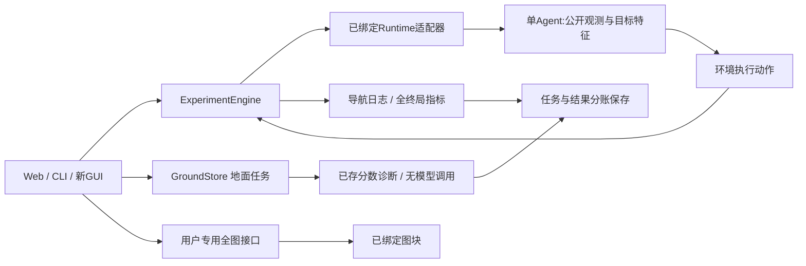

# GeoNav实验内核：4.9.1保存与异常隔离

当前Web使用service_v8.Workbench与scene_workspace_v2.SceneWorkspace。保存后立即只读，重复保存直接返回既存快照；只加载规范命名、SHA和父场景身份有效的终局。未提交文件不进入目录，坏记录原址隔离并由catalog.recovery公开提示；其它有效场景可运行。旧4.9算法step/状态/指标模块作为明确依赖保留，不改科研默认。

新运行额外绑定实际执行源码，旧记录不倒填身份。[修复与验证](../../../平台/实验工作台_v4/场景交互复查与修复_v1/README.md)。下列4.9接口说明继续有效；新场景仍由Python/Web调用，CLI未新增场景子命令。

# GeoNav实验内核：4.9自由场景

当前Web由service_v7.Workbench组合SceneWorkspace与既有4.8功能。新内核scenes提供create/save_scene/start/mode/step/cancel/state/save_run/compare/catalog/image/heartbeat/release，Web只调用内核；手动零模型，Agent接管只同步真实观测前缀，未访问图块不给策略。scene默认内存，显式保存配置/终局到store/scenes；人工/混合与纯Agent分账。详见[4.9使用与边界](../../../平台/实验工作台_v4/场景配置与手动探索_v1/README.md)。

旧CLI保持原导航与地面命令，新场景目前由Python/Web调用，不宣称新增场景CLI。下面4.8模块保留为运行依赖。

# GeoNav实验内核：航拍导航与地面任务

地面任务采用独立组件`ground_tasks_v2.GroundStore`和`cli_v4`：登记已知开发目标或自由上传、运行已存分数诊断、临时租期释放/正式保存、重开和新ID复跑。与航拍共用store锁和工作目录；正式GUI4.8由`service_v6.Workbench`组合两者，原地面接入与恢复已通过19及14项接口/GUI/冷启动核验，新增试跑流程通过11项合成与真实工程核验，见[当前交付](../../../平台/实验工作台_v4/试跑保存与同题对照_v1/README.md)。地面组件不调用模型，不提供地面导航；未知图无缓存时拒绝诊断，不能把旧样例结果用于新照片。CLI与GUI读取同一GroundStore，CLI只用独立或空闲store。

内核与HTTP、HTML、浏览器无关。当前Web/Python使用service_v6.Workbench，继承service_v3模型身份绑定与原v2导航执行逻辑；method_catalog_v1提供不加载模型的目录/快照。旧记录缺项保留，不倒填当前模型。CLI_v2继续兼容原航拍命令；地面任务使用CLI_v4。旧绑定原件保留；`engine_v2.py`负责航拍数据/任务、持久实验、单步/单题/队列控制、预算、日志及指标；`service_v2.py`绑定原Masa/Native/上传执行器和只读案例；`storage_v1.py`防止同一数据目录并发写入。当前原执行器仍在webapp名称下作为冻结适配依赖，未改其代码；它们不需要网页运行。

```powershell
& 'D:/PYTHON/python.exe' -B -m project.src.platform_core.cli_v2 --help
& 'D:/PYTHON/python.exe' -B -m project.src.platform_core.cli_v2 --store '独立工作台目录' catalog
& 'D:/PYTHON/python.exe' -B -m project.src.platform_core.cli_v2 --store '独立工作台目录' run '配置.json' --scope queue
```

配置和网页采用相同字段：dataset_id、name、task_keys、arms、seeds。先创建新实验，定义/输入/源码SHA冻结，再执行。CLI与网页不能同时拥有同一store；实验重新打开只查看，复跑另建。CLI的单题模式退出后余题须另建或通过持久服务运行，不能把已经退出进程的内存当可恢复状态。

Python调用 `Workbench(root,store)`，然后 define(spec)、control(id,'step'/'run_episode'/'run_queue',row_index=...,interval_ms=...)、state(id)、export_csv(id)。单题结束暂停；队列继续未完题；展示速度不进入Agent输入/奖励。暂停未完题的运行态只在当前进程保存，最多4题，切换不会重置其记忆；重启标中断，不能盲续跑。



`image`按轨迹前缀限制可见图；`observer_image`是用户/评测器通道，校验同一影像SHA，仅显示全图。运行器不调用此接口，开关不改变访问记忆、特征、决策、预算或日志。Python对象不是恶意代码沙箱。

当前可执行适配：Masa S2/S3 5×5/B10；MassGIS已消费开发5×5/B10与10×10/B20；用户登记5/10格。模型保持冻结Small256/Edge，无训练或扩参。`evidence_catalog()`按当前实验索引返回研究/数据/工程与材料目录，不写死批次数，不自动执行旧训练/准备/确认脚本。

新协议接入 `register_runtime_adapter(origin,factory,source_sha256=...)`，需在创建实验前登记并绑定源码；补足明确的数据注册、行动/信息权限、指标/原日志对照后再新增适配。所有历史协议尚未自动接入实时运行，注册机制不等于已完成其科学验收。


临时模式：define({...原配置, temporary: True, owner: 32位小写十六进制页面会话})；heartbeat(owner)续租、release_owner(owner)停止未来动作并释放自己的试验，reap_expired()清理超时会话。HTTP适配器调用assert_access保护临时读取/操作，不把页面会话传给Agent。默认lease_seconds=180；每页4试验/服务16试验。运行中的模型调用结束后释放，不能强制撤回。临时定义/进度/动作/结果/seal均不写磁盘；显式导出另论。

Python与CLI缺省temporary=False，正式持久保存兼容原记录；上传数据与任务清单不是临时实验的附属缓存，页面关闭不会删除。Web默认勾选临时，页面内切换功能页不释放，关闭/刷新/离开页面释放；异常断连超时兜底。

独立目录的真实流程验收见[便携闭环](../../../平台/实验工作台_v4/便携闭环_v1/README.md)：8轨迹/160CPU步、保存/重启/同配置复跑及原封存输出一致。复用本机依赖，未声称新环境完整复跑。

当前地面核心为ground_tasks_v2：新记录暂存提交、旧异常原址保留并只读隔离、合法长名复跑；CLI_v4新增recovery。历史审计使用tools.audit_ground_release_v2的history，部署检查使用deployment，两者分开，不固定当前索引长度。

## 保存试跑与跨记录对照（4.8）

`service_v6.Workbench`新增`save_trial(id, owner)`、`fork_same_tasks(id, owner, arm)`和`compare_saved_runs(left, right, owner)`，不依赖HTTP/GUI。save仅支持ready或已终止试跑，拒绝执行中/暂停内存迁移；新正式ID保留原绑定/逐行输出，暂存原子提交，重复请求幂等。fork先要求原试跑已保存，固定任务/预算/种子，只选择一个已有策略，始终创建临时新记录而不运行。compare仅对同题同权重集合且公共输入SHA一致的已完成行计恢复/损伤，未完成配对另报。暂停后请完成或结束再保存；不新增地面导航能力。CLI_v4仍是原命令，新方法可由Python或Web调用。
