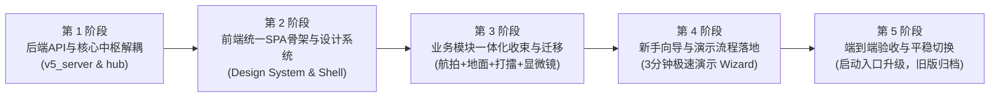

# GeoNav 平台 V5.0 一体化重构与全景功能设计方案

> **文档性质**：新一代平台架构规划与重构路线图方案  
> **规划版本**：V5.0-Draft  
> **对标现状**：GeoNav V4.18 (workbench_server_v27 + service_v16 + controller_hub_v2)  
> **编制日期**：2026-11-09  

---

## 目录
1. [一、 现状解剖：现存平台功能全景与技术拼凑成因](#一-现状解剖现存平台功能全景与技术拼凑成因)
2. [二、 现存系统核心痛点深度剖析](#二-现存系统核心痛点深度剖析)
3. [三、 平台 V5.0 重构目标与核心设计哲学](#三-平台-v50-重构目标与核心设计哲学)
4. [四、 平台 V5.0 全景功能架构蓝图](#四-平台-v50-全景功能架构蓝图)
5. [五、 交互界面与工作空间设计（一体化单页体系）](#五-交互界面与工作空间设计一体化单页体系)
6. [六、 统一后端服务与数据通信架构设计](#六-统一后端服务与数据通信架构设计)
7. [七、 落地实施路线图：从哪里下手开始搭建？](#七-落地实施路线图从哪里下手开始搭建)
8. [八、 阶段成果验收门槛与平稳迁移保障](#八-阶段成果验收门槛与平稳迁移保障)

---

## 一、 现状解剖：现存平台功能全景与技术拼凑成因

现行平台（GeoNav V4.18）是在数个科研迭代周期（CV030~047、PLATFORM-029~034）中逐步追加演化而来的。随着课题从“无人机纯航拍定位”向“跨视角地面弱 GPS 定位”以及“大模型云端 API 对照”不断拓宽，系统积累了丰富的能力，但底层采用了多套独立界面的拼合方案。

### 1.1 现存 7 大分散模块及功能清单

| 模块名称 | 访问路由 | 核心服务/文件依据 | 现有功能边界 |
|---|---|---|---|
| **1. 统一探索控制台** | `/controllers` | `controller_console_v1.html`<br>`controller_console_v3.js` | · 航拍单题自主导航与人工控制<br>· 支持 M0 超轻量模型策略、Frontier 前沿拓展规则、人工接管<br>· 遥感底图 10×10 网格、步进状态、实时航拍图与目标图对比<br>· 双会话同题对比（Side-by-Side Compare）、轨迹 JSON 导出 |
| **2. 云端 API 对照打擂台** | `/controller-api` | `controller_api_panel_v1.html`<br>`api_controller_v1.py` | · 兼容 OpenAI 格式的大模型 API（智谱 GLM、阿里百炼 Qwen 等）接入<br>· 固定 10 题标准测试集与离线评测回放<br>· 云端 API vs 本地 M0 模型同题指标打擂（成功率 SR、曼哈顿距离 SG、耗时、回退率）<br>· 结果数据表、CSV/JSON 导出 |
| **3. 拍摄点地面任务库** | `/capturepoints` | `capturepoint_tasks_v2.html`<br>`capturepoint_catalog_v1.py` | · 地面弱 GPS 场景 192 道实拍任务检索与目录预览<br>· 目标地物真实照片展示、起点观测照片比对<br>· 地面视点人工逐步走动探索、会话状态保存与回放 |
| **4. 地面连续观测与实时证据** | `/ground-walk`<br>`/ground-live` | `ground_walk_v1.html`<br>`ground_live_v3.js` | · 地面连续图块空间拓扑连通探索<br>· 实时相机观测流生成、已访图块记忆缓冲池<br>· 历史步进与全景观测图导出 |
| **5. 空间感知与特征证据显微镜** | `/spatial-evidence`<br>`/perception` | `spatial_evidence_v1.html`<br>`perception_reader_v1.py` | · CV031 局部感知候选证据切片、激活响应图查看<br>· CV041 普通 RGB 空间头与方向视图特征向量对照<br>· 特征相似度分布与空间几何误差校准详情 |
| **6. 自由场景仿真沙箱** | `/scenes` | `scene_workspace_v1.html`<br>`scene_workspace_v3.py` | · 遥感大图自由选区、瓦片加载与边界设定<br>· 自定义起点/目标点、障碍格阻挡配置<br>· 自由手动探索步进与曼哈顿距离实时演算 |
| **7. 历史实验综合工作台** | `/workbench` | `workbench_server_v12/v27`<br>`batch_table` 组件 | · 历史冻结实验批次数据检索与统计汇总<br>· 静态图表展示与多批次历史成果存档查阅 |

---

## 二、 现存系统核心痛点深度剖析

根据实际运行测试与用户反馈，当前平台存在以下四大致命硬伤：

### 2.1 严重碎片化与“缝合拼凑感”
- **页面跳转割裂**：平台并不是一个连贯的应用，而是 7~8 个不同时期制作的 HTML 散乱并存。用户在不同功能间切换时，必须点击外链重载整个网页，破坏了交互连贯性。
- **底层热补丁侵入**：`workbench_server_v27.py` 为了把这些散乱页面串起来，在 HTTP 发送层（`send()` 方法）中充斥了大量基于正则表达式和字符串替换的动态 HTML 劫持（例如 `blob.replace(b'</nav>', '<a href="/controllers">...</a>')`、`blob.replace(b'<footer>', panel.read_bytes())`），代码极度脆弱。

### 2.2 视觉设计规范与交互逻辑完全混乱
- **界面画风割裂**：有的页面使用极黑深邃主题（`controller_console_v1.css`），有的页面采用亮白浅灰卡片（`capturepoint_tasks_v1.css`），有的页面是旧式表格（`workbench`），字体、边距、按钮圆角毫无规范。
- **信息呈现不一致**：同一个“剩余距离”，在航拍界面叫“Manhattan Distance”，在地面界面叫“Target Offset”，在 API 对照界面叫“SG”，增加人类理解负担。

### 2.3 功能冗余重叠，资源利用率低下
- **重复造轮子**：网格地图渲染、坐标计算、当前观测/目标图对比、轨迹路径绘制在至少 4 个独立的 JS 文件中分别实现了 4 套不同的 Canvas/DOM 代码。
- **状态不互通**：用户在 `/controllers` 中正在运行或暂停的仿真任务，跳转到 `/capturepoints` 或 `/controller-api` 后无法感知，甚至可能造成后端并发冲突。

### 2.4 新手引导与演示友好度为零
- **门槛极高**：初次使用者（如导师、评审专家、新组员）进入后，面对数十个晦涩参数（M0、Frontier、BA、Radius Guard、CCVPE、S2/S3）无从下手。
- **缺乏向导模式（Wizard）**：缺少“一键启动经典演示”、“典型成功案例回放”、“人机接管对比”等面向演示的一键化工作流。

---

## 三、 平台 V5.0 重构目标与核心设计哲学

新一代平台 V5.0 确立**“一平、四化、一收束”**的设计哲学：

```
┌────────────────────────────────────────────────────────────────────────┐
│                        平台 V5.0 核心设计哲学                          │
├────────────────────────────────────────────────────────────────────────┤
│  1. 单页一体化 (SPA)     │ 彻底终结跨页面跳转，单中台统一工作区        │
│  2. 视觉规范化 (Design)  │ 统一学术科技风 Design System，深/浅模式自适应│
│  3. 全程向导化 (Wizard)  │ 内置 3 分钟极速演示流程与智能操作气泡引导    │
│  4. 模块组件化 (Modular) │ 统一地图引擎、统一对比视窗、统一时间轴控制台 │
│  5. 内核收束化 (Unified) │ 废除层层继承，单入口异步 REST + WebSocket 驱动│
└────────────────────────────────────────────────────────────────────────┘
```

1. **单页一体化（All-in-One SPA）**：所有功能（航拍导航、地面探索、模型打擂、特征显微镜、自由沙箱）均收归在单一单页架构下，左侧模式切换，中区视窗无缝变形，状态全程保持。
2. **零代码冗余与全功能保留**：彻底清理重复代码，将分散的地图渲染与对比视窗收敛为通用组件；**100% 完整保留先代已验证的航拍 M0、Frontier、地面 192 题库、云端 API 打擂、特征显微镜等所有核心科研能力**。
3. **沉浸式演示与向导工作流（Onboarding First）**：专设“导师/组员演示向导”，提供 3 条黄金演示脚本（经典航拍 10 步精准到达、弱 GPS 地面人机协作寻路、本地小模型与千亿云端大模型同台竞技），一键自动装载运行。

---

## 四、 平台 V5.0 全景功能架构蓝图

平台 V5.0 将原有的分散功能提炼整合为 **4 大核心业务中枢 + 1 个全局支撑底座**：

```mermaid
graph TD
    subgraph V5["GeoNav 平台 V5.0 一体化全景架构"]
        subgraph TopBar["顶层状态与全局向导总线 (Global Control & Onboarding)"]
            A1["⚡ 3分钟极速演示向导 (Wizard)"]
            A2["📊 全局状态胶囊 (模式/步数/距离/状态)"]
            A3["⚙️ 运行环境与模型引擎监控"]
            A4["🌗 明暗主题切换 / 会话保存与导出"]
        end

        subgraph CoreHub["四大业务功能工作台 (SPA 核心视区)"]
            B1["🚁 航拍视听导航中心<br>(Aerial Navigator)"]
            B2["📷 地面弱GPS定位中枢<br>(Ground Camera Explorer)"]
            B3["⚔️ 模型对抗与API竞技场<br>(Benchmark & API Arena)"]
            B4["🔬 轨迹特征与证据显微镜<br>(Evidence & Trace Lens)"]
        end

        subgraph SharedComponents["共享原子组件库 (Reusable UI Components)"]
            C1["🗺️ 统一视网膜级网格地图 (Canvas 2D/WebGL)"]
            C2["🖼️ 智能双视窗对比器 (Observation vs Target)"]
            C3["⏱️ 统一时序推演控制器 (Step / Auto / Pause / Slider)"]
            C4["📈 实时指标动态仪表板 (SR / SG / Confidence / Latency)"]
        end

        subgraph Backend["统一轻量后端引擎 (Unified Core Backend)"]
            D1["📡 统一 HTTP/WebSocket 接口服务 (FastAPI / 异步原生服务)"]
            D2["🧠 统一控制器管理器 (Aerial / Ground / API / Evidence Controller)"]
            D3["💾 统一存储与会话管理器 (Session, Trajectory, Export)"]
        end
    end

    TopBar --> CoreHub
    CoreHub --> SharedComponents
    SharedComponents <--> Backend
```



### 4.1 四大业务功能工作台深度定义

#### 业务工作台 1：🚁 航拍主动导航中心（Aerial Navigator）
- **功能集成**：收拢原 `/controllers` 航拍部分与 `/scenes` 仿真沙箱。
- **核心能力**：
  - 支持 **M0 双分支轻量模型（0.93M）**、**Frontier 拓扑规则**、**多 Agent 协作试跑** 与 **人工接管（WASD/方向键）** 自由热切换；
  - 遥感图 10×10 网格动态渲染，标明已访问足迹、当前无人机视点、预测目标概率热力图；
  - 决策置信度实时仪表、径向保护警报指示灯、步数与距离实时计算；
  - 自由沙箱模式：支持导入自定义遥感区域、手动设置起点/终点与障碍物。

#### 业务工作台 2：📷 地面弱 GPS 跨视角定位中枢（Ground Camera Explorer）
- **功能集成**：收拢原 `/capturepoints`（192 题库）与 `/ground-walk` / `/ground-live`。
- **核心能力**：
  - 192 道实拍拍摄点任务智能筛选（按区域、光照、视角偏差度分级检索）；
  - 目标实景照片与无人机俯瞰基准图视差特征匹配展示；
  - 连续观测视点步进探索、地面局部拓扑图块缓存记忆管理；
  - 标注质量核验与探索完成度判定。

#### 业务工作台 3：⚔️ 模型对抗与 API 竞技场（Benchmark & API Arena）
- **功能集成**：收拢原 `/controller-api` 与历史 `/workbench` 批量测试能力。
- **核心能力**：
  - **同台竞技模式（Side-by-Side Arena）**：左屏跑本地 M0 超轻量模型，右屏跑云端 VLM/LLM（OpenAI 兼容接口）；
  - **固定十题标准集** 同步推演，毫秒级比对两者在同一步骤的动作决策、耗时与距离增量；
  - 实时对比大盘：成功率（SR）、终局曼哈顿距离（SG）、单步耗时、Token/请求开销、异常回退率；
  - 评测结果一键生成标准科研格式报表（支持 CSV、JSON、交互图表导出）。

#### 业务工作台 4：🔬 轨迹时序与证据显微镜（Evidence & Trace Lens）
- **功能集成**：收拢原 `/spatial-evidence` 与 `/perception` 特征诊断。
- **核心能力**：
  - **历史轨迹时间轴回放（Timeline Scrubber）**：支持拖拽时间滑块，毫秒级复现历史任务的每一步现场；
  - **特征注意力热力图**：查看神经网络在遥感图与目标图之间的交叉注意力分布（Cross-View Attention）；
  - **局部空间感知小头（CV041）特征诊断**：普通 RGB 空间监督特征与方向向量对齐验证；
  - 失败根因诊断分析器（标记因越界、原地徘徊、或注意力漂移导致的失败）。

---

## 五、 交互界面与工作空间设计（一体化单页体系）

### 5.1 界面栅格与四区布局规范（Layout Matrix）

```
+----------------------------------------------------------------------------------------------------+
| [Logo: GeoNav 5.0]  [向导: 3分钟演示]  [模式选择器: 航拍 | 地面 | 打擂 | 证据]    (步数: 4/15 | 距离: 2) [主题] [导出] |
+---+---------------------------------------------------------+--------------------------------------+
| M |                      中央主交互画布                      |               右侧动态分析抽屉        |
| O |                   (Central Canvas Area)                 |         (Contextual Inspector)       |
| D |                                                         |                                      |
| E |  +-----------------------------+  +------------------+  | 模式 1 (航拍):                       |
|   |  | 统一网格地图/遥感底图        |  | 实时图像对比视窗 |  |  · 决策动作分布 (上42% 右38% 下10%) |
| R |  |                             |  |  +------------+  |  |  · 置信度与径向保护状态指示灯       |
| A |  |  [S] -> · -> · -> [Current] |  |  | 目标航拍图 |  |  |  · 探索策略切换 (M0 / Frontier)    |
| I |  |                   ↓         |  |  +------------+  |  |                                      |
| L |  |                  [Goal]     |  |  | 当前观测图 |  |  | 模式 3 (打擂):                       |
|   |  |                             |  |  +------------+  |  |  · M0 成绩: SR 60% / SG 1.2          |
|   |  +-----------------------------+  +------------------+  |  · 云端API: SR 10% / SG 4.8          |
|   |                                                         |  · 实时耗时与 Token 消耗对比         |
+---+---------------------------------------------------------+--------------------------------------+
|   | 统一时序推演与交互控制台 (Bottom Control Bar)                                                 |
|   | [⏮ 上一步]  [▶ 自动执行]  [⏸ 暂停]  [⏭ 下一步]  [重置]   进度轴: ──●───────── (Step 4/15)  [WASD接管] |
+---+------------------------------------------------------------------------------------------------+
```

### 5.2 核心统一组件库定义（Design System）

1. **统一调色板（Palette）**：
   - 主色调（Primary）：深海科技蓝 `#0F2744` / 智慧青 `#00A3BF`；
   - 状态色：成功绿 `#10B981`、警示橙 `#F59E0B`、失败/越界红 `#EF4444`；
   - 界面底色：暗色模式采用极具质感的深空石墨灰 `#0B1120`，浅色模式采用学术纸感白 `#F8FAFC`。
2. **统一地图引擎（Map Canvas Engine）**：
   - 采用统一的轻量级 HTML5 Canvas 绘制引擎，彻底替换各页面重复的 DOM 拼接；
   - 支持高帧率平滑缩放与拖拽平移，轨迹连线带动态光效粒子，目标点带呼吸脉冲动效。
3. **统一时序推演条（Timeline Controller）**：
   - 单步走（Step）、自动推演（Auto）、暂停（Pause）、重置（Reset）；
   - 进度滑块（Scrubber）：拖动即可穿梭至任意步骤，主视窗图像与指标同频同步。

---

## 六、 统一后端服务与数据通信架构设计

### 6.1 废除层层包装，构建扁平化统一服务

现有后端的严重问题是类继承链过长（`service_v1` → `v12` → `v14` → `v15` → `v16`；`server_v1` → `v12` → `v21` → `v24` → `v27`）。  
**V5.0 解决方案**：构建单一扁平的 `platform_core/v5/` 核心服务，将能力解耦为可插拔的 Provider。

```
project/src/platform_core/v5/
  ├── v5_server.py           # 统一单服务入口 (端口 8769, 干净路由)
  ├── hub.py                 # 全局核心控制器中枢 (Orchestrator)
  ├── providers/
  │   ├── aerial_engine.py   # 航拍与 M0 推理引擎 (调用轻量 PyTorch 权重)
  │   ├── ground_engine.py   # 地面拍摄点与图块连续拓扑引擎 (192 题库)
  │   ├── api_arena.py       # 大模型 API 调度与打擂引擎
  │   └── trace_lens.py      # 轨迹回放与特征分析引擎
  └── storage.py             # 统一会话存储、导出与日志审计
```

### 6.2 统一 API 路由体系（RESTful + WebSocket）

| 路由路径 | 方法 | 功能描述 |
|---|---|---|
| `/v5/` | GET | 交付单页完整应用（HTML/CSS/JS 静态闭包） |
| `/v5/api/system/info` | GET | 获取平台版本、可用引擎（M0/Frontier/API）、环境状态 |
| `/v5/api/session/create` | POST | 创建新会话（指定模式：航拍、地面、打擂、沙箱） |
| `/v5/api/session/step` | POST | 执行一步推演（指定动作：上/右/下/左/模型自主推理） |
| `/v5/api/session/auto` | POST | 开启/暂停自动连续推演 |
| `/v5/api/session/state` | GET | 获取当前会话状态、坐标、已访图块、指标 |
| `/v5/api/session/image` | GET | 统一获取视窗图像（当前观测图、目标航拍图、地物照片） |
| `/v5/api/arena/benchmark` | POST | 触发十题/自定义题库打擂评测 |
| `/v5/api/export` | GET | 统一导出轨迹、诊断图表或评测报告（JSON/CSV） |
| `/v5/ws/live` | WebSocket | 实时推送自动导航轨迹点、决策概率分布与帧画面（可选低延迟流） |

---

## 七、 落地实施路线图：从哪里下手开始搭建？

重构必须兼顾**“当前系统稳定可用”**与**“新版本平稳演进”**，坚决避免一次性推倒重来导致现有中期汇报与 Demo 瘫痪。采用**“并行构建、组件提炼、逐步吸收、平稳切换”**的 5 阶段路线：



### 阶段详细任务拆解：

#### 阶段 1：后端统一中枢与 API 协议构建（从平台中枢下手）
- **核心动作**：
  1. 新建 `project/src/platform_core/v5/` 架构目录；
  2. 实现 `hub.py` 控制器中枢，将原 `controller_hub_v2`、`api_controller_v1`、`capturepoint_catalog_v1` 包装为统一接口；
  3. 搭建纯净的 `v5_server.py`，实现标准 REST API，摆脱旧版通过继承和 `blob.replace` 劫持 HTML 的怪异实现；
  4. 验证核心 API（状态、步进、图像交付、评测触发）在沙箱端口（如 8798）上跑通。

#### 阶段 2：前端现代 SPA 骨架与统一设计系统搭建
- **核心动作**：
  1. 制定统一 CSS 变量规范（`v5_theme.css`），统一深浅主题色彩、间距、字体与阴影系统；
  2. 研发统一的 Canvas 网格渲染引擎（`v5_canvas_map.js`）与双视窗图像对比组件（`v5_view_comparator.js`）；
  3. 实现 SPA 页面路由管理器（支持左侧 Mode Rail 瞬间无缝切换工作台，零整页刷新）。

#### 阶段 3：四大业务工作台逐一收拢与功能去重
- **核心动作**：
  1. **航拍导航移植**：将 M0 与 Frontier 接入新统一地图视窗与控制台，实现平滑运动动画；
  2. **地面拍摄点融合**：将 192 题库筛选与地面连续步进直接嵌入同一视窗，共用底图与对比器；
  3. **打擂台一体化**：将单模型 API 对抗整合为实时分屏打擂卡片，动态渲染对比图表；
  4. **显微镜整合**：挂载时序滑块与特征注意力热力图。

#### 阶段 4：3 分钟新手向导与演示预设系统（解决引导差问题）
- **核心动作**：
  1. 设计轻量级自研气泡向导（Wizard Tour），首次进入自动弹出引导卡片，高亮关键功能区；
  2. 内置 3 套经典演示预设（Preset 1: 航拍典型成功 10 步精准入洞；Preset 2: 地面拍摄点跨视角人机协同；Preset 3: 本地 M0 vs 云端大模型 10 题对抗）；
  3. 顶栏专设“一键演示模式”按钮，点击后自动以舒适速度推演典型任务并高亮成果指标。

#### 阶段 5：全量回归测试、平稳切换与历史淘汰归档
- **核心动作**：
  1. 运行 68 项既有单元测试与沙箱端到端冒烟测试，确保科研指标（SR/SG）计算与历史 100% 吻合；
  2. 更新 `平台/启动平台.cmd` 与 `平台/启动平台.ps1`，默认启动 V5.0 服务；
  3. 将被完全替代的旧版散落文件（`workbench_server_v24~v27.py`、`controller_console_v1~v3.js` 等）严格按照项目规则移入 `归档/project/src/...` 并更新生命周期账本。

---

## 八、 阶段成果验收门槛与平稳迁移保障

为确保重构过程绝不破坏现有科研成果和展示稳定性，设定以下硬性验收指标：

1. **零功能丢失（Zero Regressions）**：
   - 现存 M0（0.93M）、Frontier、地面 192 题库、云端 API 十题打擂、特征证据切片等全部关键资产 100% 在 V5.0 中可运行、可复现；
   - 指标计算逻辑（曼哈顿距离 SG、成功判定 SR、10 步预算）严格一致。
2. **零整页跳转（True Single Page Application）**：
   - 任何子功能（航拍、地面、打擂、显微镜、沙箱）之间的切换时间 < 50ms，且无整页刷新，内存会话不丢失。
3. **极简启动与环境纯净（Clean Delivery）**：
   - 单命令双击启动，零额外复杂前端构建链（保持纯原生现代 Web 技术，无需臃肿 node_modules 打包才能运行），确保便携式 Demo 能秒级拉起；
   - 端口独占干净，关闭时进程与端口零残留。
4. **人类操作友好度（Usability）**：
   - 全新用户（导师或组员）能在无需翻阅开发文档的情况下，通过“演示向导”在 3 分钟内完成全套核心功能体验。

---
*注：本方案作为平台 V5.0 重构的核心指导纲领，后续开发认领与具体代码落盘将严格依据本路线图分批推进。*
